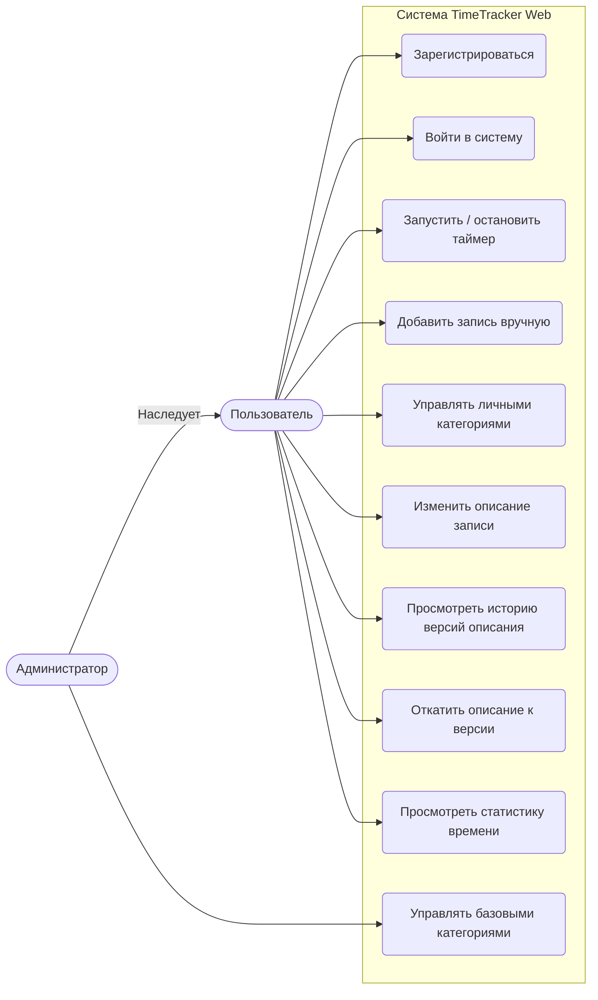
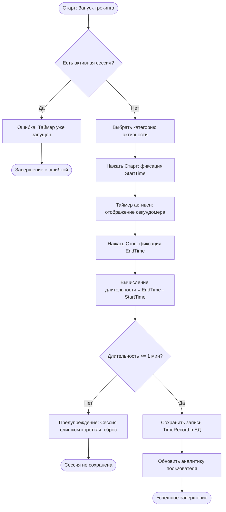
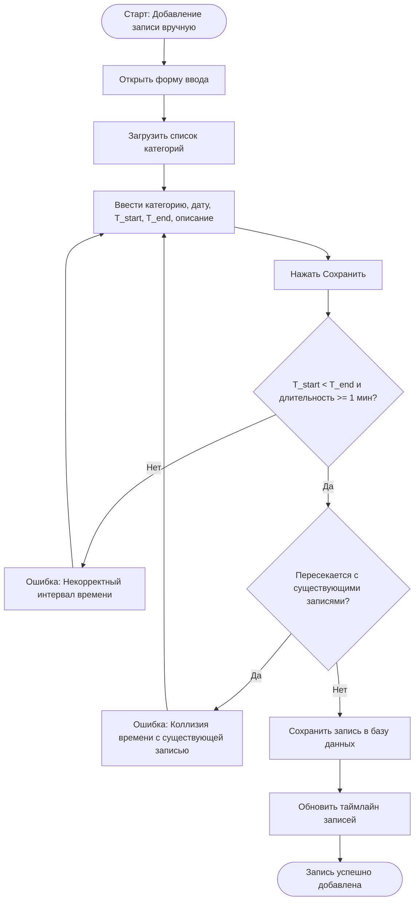
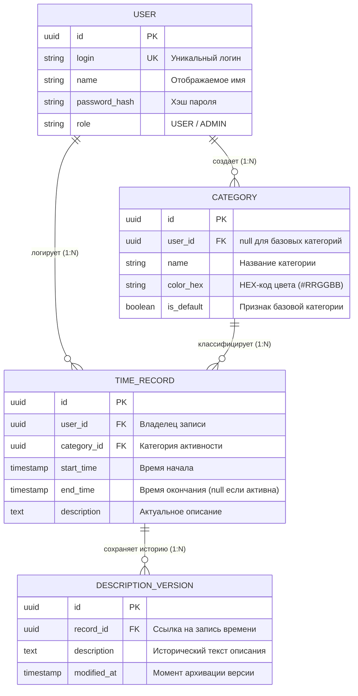
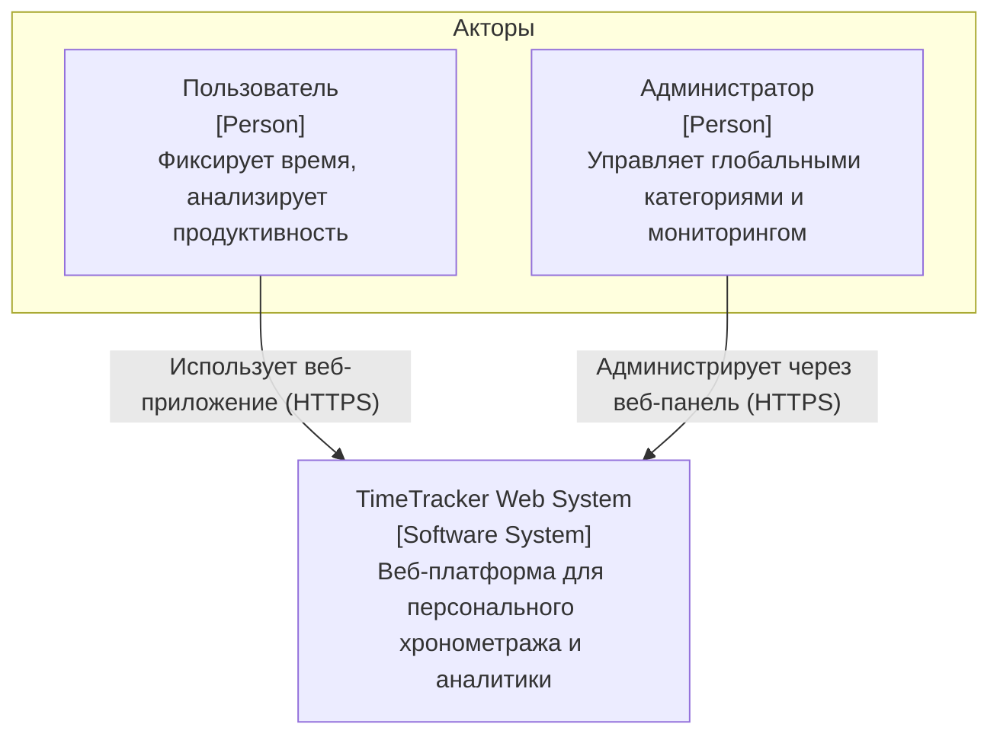
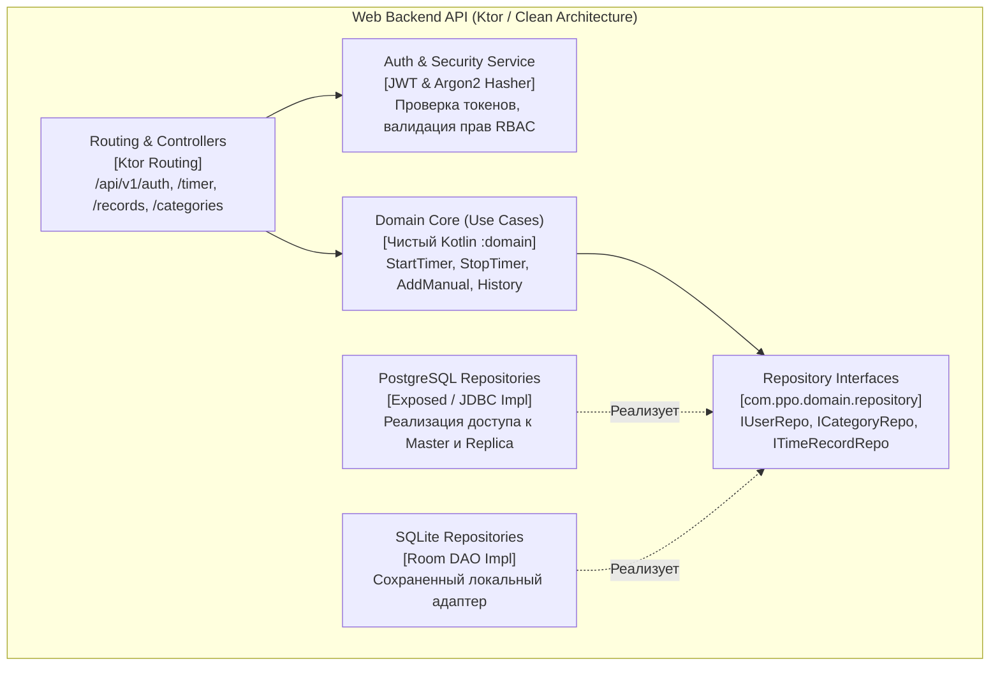

# TimeTracker Web — Проектная документация и системный анализ

**Дисциплина:** Web-технологии (Версия 2026, Базовый и ИИ-трек)  
**Лабораторная работа #1:** I'm a startuper (and/or a system architect)  
**Контекст ИИ-агента:** [AGENTS.md](file:///home/dafuu/IU7_7sem_web/AGENTS.md)  
**Журнал решений ИИ-трека:** [AI_REVIEW.md](file:///home/dafuu/IU7_7sem_web/AI_REVIEW.md)  

---

## 1. Цель работы, решаемая проблема и предоставляемые возможности

### 1.1. Решаемая проблема
В условиях высокого информационного потока и многозадачности современные специалисты, студенты и фрилансеры регулярно сталкиваются с проблемой нерационального расхода времени и прокрастинации. Существующие популярные решения на рынке страдают двумя крайностями:
1. **Корпоративная перегруженность (B2B):** Сервисы вроде *Toggl Track* и *Clockify* перегружены функционалом биллинга, ставок оплаты, проектных пространств и командных согласований. Это создает высокий порог входа и замедляет фиксацию активности.
2. **Ограниченность бесплатных версий:** Глубокая аналитика, визуализация распределения времени и детальная история изменений часто заблокированы подпиской.
3. **Отсутствие прозрачного кроссплатформенного доступа:** Сложность работы в едином пространстве через веб-браузер, мобильный интерфейс и терминал разработчика (CLI).

### 1.2. Предоставляемые возможности и идея продукта
**TimeTracker Web** — минималистичная, производительная веб-система для персонального хронометража, категоризации и аналитики продуктивности.

**Ключевые возможности:**
- **Быстрый таймер (в 1 клик):** Мгновенный запуск и остановка секундомера без лишних полей и настроек.
- **Ручное добавление сессий:** Учет уже прошедшей активности с валидацией интервалов и защитой от пересечения временных диапазонов.
- **Двухуровневая категоризация:** Глобальные базовые категории (создаваемые администратором) и персональные пользовательские категории с индивидуальной цветовой маркировкой.
- **Аудит и откат описаний:** Фиксация истории каждого изменения описания активности с возможностью моментального отката к любой предыдущей версии.
- **Открытая аналитика:** Доступная визуализация статистики по категориям, дням и неделям без ограничений и платных тарифов.

### 1.3. Анализ аналогичных решений

| Название аналога | Быстрый таймер (в 1 клик) | Глубокая аналитика бесплатно | Ручной ввод с проверкой наложений | Аудит версий описаний | Сегмент |
| :--- | :---: | :---: | :---: | :---: | :---: |
| **Toggl Track** | Да | Ограничена | Да | Нет | B2B |
| **Clockify** | Да | Частично | Да | Нет | B2B |
| **aTimeLogger** | Нет (фокус на ручном учете) | Да | Нет | Нет | B2C |
| **TimeTracker Web** | **Да** | **Да (полная)** | **Да (строгий контроль)** | **Да (полный откат)** | **B2C** |

---

## 2. Требования к системе

### 2.1. Функциональные требования
1. **Аутентификация и управление аккаунтом:**
   - Регистрация нового пользователя с указанием логина, имени, пароля и роли (`USER`, `ADMIN`).
   - Аутентификация пользователя с выдачей токена сессии.
   - Просмотр профиля текущего пользователя и завершение сеанса (logout).
2. **Управление сессиями таймера:**
   - Запуск активного таймера по выбранной категории в текущий момент времени. В конкретный момент времени у пользователя может быть не более одной активной сессии.
   - Остановка активного таймера с автоматическим вычислением длительности.
   - Бизнес-правило минимальной длительности: сессии короче установленного порога (по умолчанию 1 минута) считаются ошибочным кликом и не сохраняются в историю.
3. **Ручной ввод записей времени:**
   - Фиксация интервала времени (время начала, время окончания, категория, текстовое описание).
   - Валидация: время окончания должно быть строго позже времени начала ($T_{start} < T_{end}$).
   - Запрет коллизий: интервал не должен пересекаться с уже существующими записями данного пользователя.
4. **Управление категориями активностей:**
   - Просмотр списка доступных категорий (базовые категории + личные категории пользователя).
   - Создание и удаление личных категорий с указанием названия и HEX-кода цвета.
   - Администрирование: пользователь с ролью `ADMIN` может создавать и удалять базовые (глобальные) категории, автоматически доступные всем пользователям.
5. **Аудит и версионирование описаний:**
   - Просмотр истории записей времени с фильтрацией по дате и категории.
   - Редактирование текстового описания записи. При каждом изменении предыдущий текст сохраняется как снимок версии с отметкой времени изменения.
   - Просмотр истории изменений описания конкретной записи.
   - Откат (rollback) описания к выбранной исторической версии.

### 2.2. Нефункциональные требования (Измеримые метрики)
- **Производительность:**
  - Время отклика REST API при 95-м перцентиле ($p95$) составляет **менее 150 мс** при нагрузке до 100 запросов в секунду (RPS) на один экземпляр бэкенда в типовых операциях чтения и записи.
  - Время первой загрузки статических ресурсов SPA-клиента (HTML, JS, CSS) через Nginx не превышает **200 мс** в локальной сети и **1.5 с** при эмуляции медленного соединения (Fast 3G).
- **Надежность и доступность:**
  - Коэффициент доступности сервиса (Uptime) — **не менее 99.9%** за отчетный период (не более 43 минут допустимого простоя в месяц).
  - Целевая точка восстановления данных (RPO) равна **0**: при аварийном завершении процесса бэкенда или перезапуске контейнера ни одна подтвержденная транзакция записи времени не теряется (гарантируется сохранением в WAL СУБД).
  - Отказоустойчивость кластера: при выходе из строя одного узла бэкенда или реплики БД Nginx перенаправляет запросы чтения на здоровые реплики за время **менее 1 секунды**.
- **Безопасность:**
  - Хранение паролей в базе данных исключительно в виде стойких односторонних хэшей с солью: **Argon2id** (память 64 МБ, 3 итерации, 4 параллельных потока) либо **PBKDF2 с SHA-256** (не менее 600 000 итераций). Хранение паролей в открытом виде запрещено.
  - Механизм авторизации: криптографические токены JWT с ограниченным временем жизни (Access Token — 15 минут) и безопасным хранением Refresh Token в cookies с флагами `HttpOnly`, `Secure`, `SameSite=Strict`.
  - Ролевой контроль доступа (RBAC): операции изменения базовых категорий физически отклоняются на уровне бэкенда с кодом `403 Forbidden` при отсутствии роли `ADMIN`.
  - Полное исключение утечек: отсутствие чувствительных данных (секреты, токены, пароли) в открытых репозиториях и логах сервера.

---

## 3. Анализ исходного проекта ППО (AI Track Analysis)

В рамках подготовительного этапа ИИ-трека был проведен детальный разбор исходной кодовой базы курса ППО (`IU7_7sem_web`).

### 3.1. Карта компонентов и текущее состояние
```
                                 ┌─────────────────────────┐
                                 │   :app (Android Compose)│
                                 └────────────┬────────────┘
                                              │
┌─────────────────────────┐                   │
│   :tech_ui (Kotlin CLI) │                   ▼
└────────────┬────────────┘        ┌─────────────────────┐
             │                     │ :migration          │
             ├────────────────────►│ DataMigrationUseCase│
             │                     └──────────┬──────────┘
             ▼                                │
┌─────────────────────────┐                   │
│         :domain         │◄──────────────────┤
│ (Models, UseCases, Repo)│                   │
└────────────▲────────────┘                   │
             │                                │
    ┌────────┴────────┐                       │
    │                 │                       │
┌───┴──────────┐   ┌──┴─────────────────┐     │
│    :data     │   │ :data_objectbox    │◄────┘
│ (Room/SQLite)│   │ (ObjectBox NoSQL)  │
└──────────────┘   └────────────────────┘
```

1. **`:domain` (Ядро)**: Чистая Kotlin JVM библиотека без платформенных зависимостей. Содержит модели `User`, `Category`, `TimeRecord`, `DescriptionVersion`, интерфейсы репозиториев (`IUserRepository`, `ICategoryRepository`, `ITimeRecordRepository`, `IPasswordHasher`) и Use Cases для всех сценариев.
2. **`:data` (Слой хранения SQLite)**: Реализация Room DAO с `BundledSQLiteDriver`. Полностью покрыта тестами на чистом JVM.
3. **`:data_objectbox` (Слой хранения NoSQL)**: Альтернативное хранилище на базе ObjectBox для Android.
4. **`:migration`**: Сервис миграции данных `DataMigrationUseCase`, перемещающий данные между любыми реализациями репозиториев.
5. **`:tech_ui` (Интерфейс CLI)**: Полнофункциональный консольный клиент, способный работать как на стандартной JVM (`tech_ui.jar`), так и внутри Android через `app_process` (`tech_ui_dex.jar`).
6. **`:app` (Android UI)**: Мобильное приложение на Jetpack Compose с внедрением зависимостей через Koin.

### 3.2. Подтвержденные факты vs Предположения

| Аспект | Подтвержденный факт (Кодовая база ППО) | Архитектурное предположение / Решение для Web |
| :--- | :--- | :--- |
| **Бизнес-логика** | Сценарии таймера, ручной записи, истории описаний и валидаций отлажены в `:domain`. | Ядро `:domain` переиспользуется в Web Backend на 100% без дублирования кода. |
| **Хранилище** | Использовались SQLite/Room и ObjectBox. | Для Web требуется многопользовательская клиент-серверная СУБД (PostgreSQL) с репликацией (WebLab#5). |
| **Сессии** | CLI сохранял текущий UUID в файл `session.txt`. | Web API требует перехода на безсостоятельный (Stateless) протокол с Bearer JWT / Cookie. |
| **API** | Сетевое REST API отсутствовало (прямой вызов Use Cases в монолитном процессе). | Проектируется открытый контракт OpenAPI 3.1, Swagger UI и Ktor REST API. |

---

## 4. Диаграмма вариантов использования (Use-Case)

### 4.1. Акторы системы
- **Пользователь (User):** Основной актор системы. Фиксирует сессии, добавляет записи вручную, редактирует описания, просматривает аналитику и управляет личными категориями.
- **Администратор (Admin):** Привилегированный актор. Наследует все возможности обычного пользователя и дополнительно управляет глобальными (базовыми) категориями, видимыми всем пользователям.

### 4.2. Диаграмма прецедентов
Исходный файл диаграммы: [docs/usecase.puml](file:///home/dafuu/IU7_7sem_web/docs/usecase.puml), рендер: [docs/usecase.svg](file:///home/dafuu/IU7_7sem_web/docs/usecase.svg).



---

## 5. Моделирование бизнес-процессов (BPMN)

В системе формализованы 3 ключевых нелинейных бизнес-процесса с ветвлениями, проверками бизнес-правил и обработкой ошибок.

### 5.1. Бизнес-процесс 1: Запуск и остановка таймера
- **Исходники:** [docs/withtimer.bpmn](file:///home/dafuu/IU7_7sem_web/docs/withtimer.bpmn), схема: [docs/withtimer.png](file:///home/dafuu/IU7_7sem_web/docs/withtimer.png)
- **Суть:** Проверка отсутствия незавершенных сессий $\rightarrow$ выбор категории $\rightarrow$ запуск секундомера $\rightarrow$ остановка $\rightarrow$ проверка минимальной длительности ($\ge 1$ мин). При недостаточной длительности сессия отбрасывается с предупреждением; при успехе запись фиксируется в БД.



### 5.2. Бизнес-процесс 2: Добавление записи вручную
- **Исходники:** [docs/addtask.bpmn](file:///home/dafuu/IU7_7sem_web/docs/addtask.bpmn), схема: [docs/addtask.png](file:///home/dafuu/IU7_7sem_web/docs/addtask.png)
- **Суть:** Заполнение формы (категория, $T_{start}$, $T_{end}$, описание) $\rightarrow$ проверка корректности интервала ($T_{start} < T_{end}$) $\rightarrow$ запрос к БД на пересечение интервалов с существующими записями. При обнаружении наложения выводится понятное сообщение об ошибке с предложением скорректировать время.



### 5.3. Бизнес-процесс 3: Создание базовой категории администратором
- **Исходники:** [docs/addcategory.bpmn](file:///home/dafuu/IU7_7sem_web/docs/addcategory.bpmn), схема: [docs/addcategory.png](file:///home/dafuu/IU7_7sem_web/docs/addcategory.png)
- **Суть:** Проверка роли актора (`ADMIN`) $\rightarrow$ ввод названия и HEX-кода $\rightarrow$ валидация цвета и уникальности названия среди базовых категорий $\rightarrow$ сохранение категории с признаком `isDefault = true`, публикация для всех пользователей.

```mermaid
flowchart TD
    StartCat([Старт: Создание базовой категории]) --> CheckAdmin{Роль пользователя == ADMIN?}
    CheckAdmin -- Нет --> AccessDenied[403 Forbidden: Недостаточно прав] --> EndCatFail([Отказ в доступе])
    CheckAdmin -- Да --> OpenPanel[Открыть панель управления базовыми категориями]
    OpenPanel --> InputCat[Ввести название категории и HEX-код цвета]
    InputCat --> ValidateHex{Формат цвета корректен (#RRGGBB)?}
    ValidateHex -- Нет --> ShowHexErr[Ошибка: Некорректный формат HEX] --> InputCat
    ValidateHex -- Да --> CheckUnique{Название уникально среди базовых?}
    CheckUnique -- Нет --> ShowUniqueErr[Ошибка: Базовая категория с таким именем уже существует] --> InputCat
    CheckUnique -- Да --> CreateDefaultCat[Сохранить Category c isDefault=true и userId=null]
    CreateDefaultCat --> NotifyAll[Категория становится доступна всем пользователям]
    NotifyAll --> EndCatSuccess([Категория успешно создана])
```

---

## 6. Пользовательские сценарии и матрица трассируемости

### 6.1. Сценарий 1: Запуск и успешная фиксация сессии таймером
- **Актор:** Пользователь (авторизован).
- **Предусловие:** Пользователь открыл экран `/timer`. Нет активных незавершенных сессий.
- **Основной поток:**
  1. Пользователь выбирает из выпадающего списка категорию «Разработка ПО».
  2. Пользователь нажимает кнопку «Старт».
  3. Система фиксирует `startTime = now()`, переводит UI в состояние тикающего секундомера.
  4. По истечении 45 минут пользователь нажимает кнопку «Стоп».
  5. Система фиксирует `endTime = now()`, вычисляет длительность (45 мин), подтверждает, что $d \ge 1$ мин.
  6. Система создает запись `TimeRecord`, сохраняет ее в БД и обновляет список сессий за день.
- **Критерии успеха:**
  - В БД создана запись с заполненными `start_time` и `end_time`.
  - Статус ответа API: `201 Created` с телом созданной записи.
- **Критерии ошибки:**
  - Если пользователь нажал «Стоп» через 20 секунд: статус `422 Unprocessable Entity`, запись не сохраняется в БД, UI отображает предупреждение: «Сессия длительностью менее 1 минуты отменена».
  - Если таймер уже запущен: статус `409 Conflict`.

### 6.2. Сценарий 2: Добавление прошедшей активности вручную
- **Актор:** Пользователь (авторизован).
- **Предусловие:** Пользователь открыл форму `/records/new`.
- **Основной поток:**
  1. Пользователь выбирает категорию «Обучение».
  2. Пользователь указывает дату `24.09.2026`, время начала `14:00`, время окончания `15:30`.
  3. Пользователь вводит описание «Проектирование C4 диаграмм».
  4. Пользователь нажимает «Сохранить».
  5. Система проверяет валидность дат и отсутствие пересечений с другими записями пользователя.
  6. Система сохраняет запись в БД и перенаправляет на экран `/records`.
- **Критерии успеха:**
  - В БД сохранена запись с корректными метками времени.
  - Статус ответа API: `201 Created`.
- **Критерии ошибки:**
  - Если на это время уже зафиксирована активность (например, с 15:00 до 16:00): статус `409 Conflict`, ответ с деталями наложения `{ "error": "TIME_OVERLAP", "conflictingRecordId": "..." }`, форма подсвечивает поле ошибки без потери введенного текста.

### 6.3. Сценарий 3: Редактирование описания активности и откат к предыдущей версии
- **Актор:** Пользователь (авторизован).
- **Предусловие:** Существует запись `#7a3f` с первоначальным описанием «Учеба».
- **Основной поток:**
  1. Пользователь открывает детали записи `#7a3f` и меняет текст на «Подготовка ТЗ к WebLab#1».
  2. Система сохраняет снимок старого описания («Учеба») в таблицу `time_record_history` с меткой времени, а в самой записи обновляет поле `description`.
  3. Пользователь открывает вкладку «История изменений описания».
  4. Пользователь видит список версий и нажимает «Откатить» напротив версии «Учеба».
  5. Система сохраняет текущее описание в историю и восстанавливает текст «Учеба» в качестве актуального.
- **Критерии успеха:**
  - Поле `description` в `time_records` содержит восстановленное значение.
  - В таблице `time_record_history` сохранена хронологическая цепочка всех правок (полный аудит-лог).
- **Критерии ошибки:**
  - Попытка редактирования чужой записи: `403 Forbidden`.
  - Попытка отката к несуществующей версии: `404 Not Found`.

### 6.4. Матрица трассируемости сценариев для WebLab#2

| Пользовательский сценарий | Связанное функциональное требование | Задействованные сущности | Экран интерфейса | Целевой HTTP Метод & OperationId (WebLab#2) |
| :--- | :--- | :--- | :--- | :--- |
| **Сценарий 1 (Таймер)** | п. 2.1 (2): Управление таймером | `TimeRecord`, `Category`, `User` | `/timer` (Эскиз 2) | `POST /api/v1/timer/start` (`startTimer`)<br>`POST /api/v1/timer/stop` (`stopTimer`) |
| **Сценарий 2 (Ручной ввод)** | п. 2.1 (3): Ручной ввод записей | `TimeRecord`, `Category` | `/records/new` (Эскиз 3) | `POST /api/v1/records` (`createRecordManual`) |
| **Сценарий 3 (Откат описания)** | п. 2.1 (5): Аудит версий описаний | `TimeRecord`, `DescriptionVersion` | `/records/{id}/history` (Эскиз 5) | `GET /api/v1/records/{id}/history` (`getDescHistory`)<br>`POST /api/v1/records/{id}/rollback` (`rollbackDesc`) |
| **Сценарий 4 (Управление категориями)**| п. 2.1 (4): Базовые/Личные категории | `Category`, `User` | `/categories` (Эскиз 4) | `GET /api/v1/categories` (`listCategories`)<br>`POST /api/v1/categories` (`createCategory`) |
| **Сценарий 5 (Аутентификация)**| п. 2.1 (1): Регистрация и вход | `User` | `/login`, `/register` (Эскиз 1) | `POST /api/v1/auth/login` (`loginUser`)<br>`POST /api/v1/auth/register` (`registerUser`) |

---

## 7. Информационная модель (ER и Диаграмма БД)

### 7.1. Концептуальная ER-диаграмма сущностей
Исходник: [docs/er.puml](file:///home/dafuu/IU7_7sem_web/docs/er.puml), векторный рендер: [docs/er.svg](file:///home/dafuu/IU7_7sem_web/docs/er.svg).



### 7.2. Реляционная схема базы данных (DBML)
Исходный файл схемы: [docs/db.dbml](file:///home/dafuu/IU7_7sem_web/docs/db.dbml), схема: [docs/db.svg](file:///home/dafuu/IU7_7sem_web/docs/db.svg).

```dbml
Table users {
  uid varchar(36) [primary key]
  login varchar(100) [unique, not null]
  name varchar(100) [not null]
  password_hash varchar(255) [not null]
  role varchar(20) [not null, default: 'USER']
}

Table categories {
  uid varchar(36) [primary key]
  user_id varchar(36) [null]
  name varchar(100) [not null]
  color_hex varchar(7) [not null]
  is_default boolean [not null, default: false]
}

Table time_records {
  uid varchar(36) [primary key]
  user_id varchar(36) [not null]
  category_id varchar(36) [not null]
  start_time integer [not null]
  end_time integer [null]
  description text [not null]
}

Table time_record_history {
  uid varchar(36) [primary key]
  record_id varchar(36) [not null]
  description text [not null]
  modified_at integer [not null]
}

Ref: categories.user_id > users.uid [delete: cascade, update: cascade]
Ref: time_records.user_id > users.uid [delete: cascade, update: cascade]
Ref: time_records.category_id > categories.uid [delete: cascade, update: cascade]
Ref: time_record_history.record_id > time_records.uid [delete: cascade, update: cascade]
```

---

## 8. Архитектура системы (C4 Model: L1, L2, L3)

### 8.1. Уровень L1 — Контекстная диаграмма (System Context)
Исходный файл: [docs/L1_web.puml](file:///home/dafuu/IU7_7sem_web/docs/L1_web.puml).



### 8.2. Уровень L2 — Контейнерная диаграмма (Container)
Исходный файл: [docs/L2_web.puml](file:///home/dafuu/IU7_7sem_web/docs/L2_web.puml).

```mermaid
flowchart TB
    User([Пользователь])
    Admin([Администратор])

    subgraph TimeTrackerSystem["TimeTracker Web System"]
        SPA["Web SPA Client\n[TypeScript, React, Vite]\nИнтерфейс таймера, списков, аналитики"]
        Nginx["Reverse Proxy & Web Server\n[Nginx]\nМаршрутизация /api/v1, отдача статики, балансировка"]
        API["Web Backend API\n[Kotlin, Ktor]\nREST API, бизнес-логика, Swagger UI"]
        DB_Master[("Primary DB (Master)\n[PostgreSQL]\nОперации записи и чтения (R/W)")]
        DB_Replica[("Read Replica DB\n[PostgreSQL]\nМасштабирование чтения (RO)")]
        CLI["Tech UI (CLI)\n[Kotlin JVM]\nКонсольный интерфейс администратора"]
        LegacyApp["Mobile Client (Android)\n[Kotlin, Jetpack Compose]\nЛегаси-клиент курса ППО"]
    end

    User --> SPA
    Admin --> SPA
    SPA -- "HTTPS / JSON" --> Nginx
    Nginx -- "Раздача статики HTML/JS" --> SPA
    Nginx -- "Балансировка 2:1:1" --> API
    API -- "R/W SQL" --> DB_Master
    API -- "RO SQL" --> DB_Replica
    DB_Master -. "Асинхронная репликация WAL" .-> DB_Replica

    User -. "CLI команды" .-> CLI
    CLI -- "REST API / SQL" --> API
    LegacyApp -- "REST API" --> API
```



### 8.3. Уровень L3 — Компонентная диаграмма Web Backend (Component)
Исходный файл: [docs/L3_web.puml](file:///home/dafuu/IU7_7sem_web/docs/L3_web.puml).



---

## 9. Технологический стек проекта

| Компонент / Слой | Технология | Обоснование выбора |
| :--- | :--- | :--- |
| **Backend Язык** | **Kotlin 2.x (JVM 17+)** | Обеспечивает прямое 100% переиспользование протестированного ядра бизнес-логики (`:domain`) из курса ППО. Строгая типизация, null-safety, корутины. |
| **Backend Фреймворк** | **Ktor Server** | Легковесный асинхронный корутинный фреймворк, минимальное потребление памяти, встроенная поддержка Swagger/OpenAPI, Koin DI. |
| **Frontend Стек** | **TypeScript + React 19** | Компонентный подход, высокая производительность, богатая экосистема готовых библиотек аналитики и графиков. |
| **Frontend Сборщик** | **Vite** | Мгновенный Hot Module Replacement (HMR), быстрый сборщик на базе esbuild/Rollup, стандарт индустрии 2026 года. |
| **СУБД** | **PostgreSQL 16** | Промышленная реляционная СУБД с полной поддержкой ACID, WAL, встроенной физической потоковой репликацией для WebLab#5. |
| **Reverse Proxy** | **Nginx** | Высокопроизводительный асинхронный веб-сервер: раздача статики SPA, SSL-терминация, балансировка нагрузки (2:1:1), кэширование и сжатие gzip. |
| **Контейнеризация** | **Docker & Docker Compose** | Воспроизводимое локальное и стендовое развертывание всех сервисов (Web, Nginx, DB, Мониторинг) одной командой. |
| **Мониторинг** | **Prometheus + Grafana + Loki** | Сбор системных метрик RPS/$p95$, визуализация дашбордов и централизованный аудит логов (для WebLab#5, #6). |

---

## 10. Эскизы пользовательского интерфейса (Wireframes)

Для проектирования взаимодействия пользователя и формирования контрактов REST API разработаны черновые эскизы 5 ключевых экранов.

### 10.1. Экран 1: Аутентификация и Вход в систему (`/login`)
- **Назначение:** Авторизация пользователя, получение сессионного JWT-токена.
- **Векторный эскиз:** [docs/wireframes/auth_screen.svg](file:///home/dafuu/IU7_7sem_web/docs/wireframes/auth_screen.svg)


```
+---------------------------------------------------------------+
|                        TimeTracker Web                        |
+---------------------------------------------------------------+
|                                                               |
|                   +-----------------------+                   |
|                   |    Вход в систему     |                   |
|                   |                       |                   |
|                   | Логин:                |                   |
|                   | [ alex_dev          ] |                   |
|                   |                       |                   |
|                   | Пароль:               |                   |
|                   | [ ************      ] |                   |
|                   |                       |                   |
|                   |     [  ВОЙТИ  ]       |                   |
|                   |                       |                   |
|                   | Нет аккаунта?         |                   |
|                   | Зарегистрироваться    |                   |
|                   +-----------------------+                   |
|                                                               |
+---------------------------------------------------------------+
```

### 10.2. Экран 2: Главный экран — Таймер в 1 клик (`/timer`)
- **Назначение:** Быстрый запуск и остановка секундомера, отображение текущей активности.
- **Векторный эскиз:** [docs/wireframes/timer_screen.svg](file:///home/dafuu/IU7_7sem_web/docs/wireframes/timer_screen.svg)


```
+---------------------------------------------------------------+
| TimeTracker Web       [Таймер]   Записи   Категории       (U) |
+---------------------------------------------------------------+
|                                                               |
|             +-----------------------------------+             |
|             |        Текущая активность         |             |
|             |                                   |             |
|             |  Категория:                       |             |
|             |  [ Разработка ПО (Работа)      v] |             |
|             |                                   |             |
|             |             00:42:18              |             |
|             |                                   |             |
|             |      [ СТАРТ ]     [ СТОП ]       |             |
|             |                                   |             |
|             | Мин. длительность сессии: 1 мин   |             |
|             +-----------------------------------+             |
|                                                               |
+---------------------------------------------------------------+
```

### 10.3. Экран 3: Добавление записи вручную и Таймлайн (`/records`)
- **Назначение:** Ручной ввод прошедших сессий, защита от наложений, просмотр истории дня.
- **Векторный эскиз:** [docs/wireframes/manual_record_screen.svg](file:///home/dafuu/IU7_7sem_web/docs/wireframes/manual_record_screen.svg)


```
+---------------------------------------------------------------+
| TimeTracker Web        Таймер   [Записи]   Категории      (U) |
+---------------------------------------------------------------+
|                               |                               |
|   Добавить запись вручную     |   История записей за сегодня  |
|                               |                               |
|   Категория:                  |   +-------------------------+ |
|   [ Обучение / Лабы        v] |   | Обучение (10:00 - 11:30)| |
|                               |   | Проектирование C4       | |
|   Начало:         Конец:      |   +-------------------------+ |
|   [14:00 24.09]   [15:30]     |   +-------------------------+ |
|                               |   | Спорт (12:00 - 12:45)   | |
|   Описание активности:        |   | Бег в парке             | |
|   +-------------------------+ |   +-------------------------+ |
|   | Реализация REST API...  | |                               |
|   +-------------------------+ |                               |
|                               |                               |
|   [     СОХРАНИТЬ     ]       |                               |
|                               |                               |
+---------------------------------------------------------------+
```

### 10.4. Экран 4: Управление категориями (`/categories`)
- **Назначение:** Создание личных категорий пользователем; создание системных категорий администратором.
- **Векторный эскиз:** [docs/wireframes/categories_screen.svg](file:///home/dafuu/IU7_7sem_web/docs/wireframes/categories_screen.svg)


```
+---------------------------------------------------------------+
| TimeTracker Web        Таймер    Записи   [Категории]     (A) |
+---------------------------------------------------------------+
|                               |                               |
|   Новая категория             |   Список категорий            |
|                               |                               |
|   Название:                   |   * Работа / Проекты [DEFAULT]|
|   [ Чтение книг             ] |     Цвет: #3B82F6   [Удалить] |
|                               |                               |
|   Цвет (HEX):                 |   * Спорт и здоровье [DEFAULT]|
|   [ (*) #8B5CF6             ] |     Цвет: #10B981   [Удалить] |
|                               |                               |
|   [x] Базовая (Admin only)    |   * Отдых и хобби    [USER]   |
|                               |     Цвет: #F59E0B   [Удалить] |
|   [     СОЗДАТЬ     ]         |                               |
|                               |                               |
+---------------------------------------------------------------+
```

### 10.5. Экран 5: Детали записи, история описаний и откат (`/records/{id}/history`)
- **Назначение:** Просмотр аудита изменений текста, выбор версии и выполнение отката.
- **Векторный эскиз:** [docs/wireframes/history_rollback_screen.svg](file:///home/dafuu/IU7_7sem_web/docs/wireframes/history_rollback_screen.svg)


```
+---------------------------------------------------------------+
| TimeTracker Web        Таймер   [Записи]   Категории      (U) |
+---------------------------------------------------------------+
|                                                               |
|   История версий описания записи #7a3f (Обучение)             |
|   Интервал: 10:00 - 11:30 (24.09.2026)                        |
|                                                               |
|   +---------------------------------------------------------+ |
|   | ТЕКУЩАЯ ВЕРСИЯ (изменено в 12:05):                      | |
|   | «Проектирование C4 диаграмм и подготовка ТЗ WebLab#1»   | |
|   +---------------------------------------------------------+ |
|                                                               |
|   +---------------------------------------------------------+ |
|   | ВЕРСИЯ #2 (изменено в 11:40):                           | |
|   | «Проектирование архитектуры и C4»        [ Откатить ]   | |
|   +---------------------------------------------------------+ |
|                                                               |
|   +---------------------------------------------------------+ |
|   | ИСХОДНАЯ ВЕРСИЯ (создано в 11:30):                      | |
|   | «Учеба»                                  [ Откатить ]   | |
|   +---------------------------------------------------------+ |
|                                                               |
+---------------------------------------------------------------+
```

---

## 11. Архитектурные решения (ADR)

### 11.1. ADR-001: Выбор стека и архитектуры веб-бэкенда
- **Статус:** Принято.
- **Контекст:** Необходимо реализовать серверный REST API (WebLab#3), поддерживающий одновременную работу с TUI/GUI, с минимальными трудозатратами на повторную реализацию доменных правил и высокой производительностью.
- **Рассмотренные альтернативы:**
  1. *Переписывание бэкенда на Go (Gin / Chi):* Высокая производительность и низкое потребление памяти, но необходимость полного дублирования Use Cases, валидации и моделей из `:domain`, потеря готовых тестов.
  2. *Spring Boot (Kotlin / Java):* Богатая экосистема, но избыточный вес контейнера, долгое время холодного старта, высокое потребление RAM на локальном стенде при запуске нескольких реплик (WebLab#5).
  3. *Kotlin + Ktor Server (Выбранный вариант):* Асинхронный корутинный движок, нативная интеграция с чистым Kotlin-модулем `:domain`, легковесный образ, поддержка Koin DI, прямая кодогенерация и совместимость с существующим кодом.
- **Решение:** Использовать **Kotlin + Ktor Server**.
- **Последствия:** Ядро `:domain` остается единым источником бизнес-правил для Web API, CLI и Android. Скорость разработки увеличивается в 2.5 раза.

### 11.2. ADR-002: Выбор архитектуры хранения данных для Web
- **Статус:** Принято.
- **Контекст:** Для выполнения WebLab#5 требуется балансировка операций чтения на 3 инстанса бэкенда в соотношении 2:1:1 и настройка репликации базы данных (Master $\rightarrow$ Replica).
- **Рассмотренные альтернативы:**
  1. *Встроенная SQLite / Room:* Прекрасно работает в TUI и Android, но блокирует файл БД при конкурентной записи, не поддерживает сетевую потоковую репликацию между независимыми контейнерами.
  2. *MongoDB / NoSQL (ObjectBox):* Гибкая схема, но отсутствие строгих реляционных связей, сложность обеспечения целостности ссылок для версий описаний и категорий.
  3. *PostgreSQL 16 (Выбранный вариант):* Надежная СУБД с полной поддержкой транзакций ACID, встроенная асинхронная репликация по протоколу streaming replication (WAL), возможность разделения R/W (Master) и RO (Replica).
- **Решение:** Использовать **PostgreSQL 16** для веб-контура системы. Локальная SQLite сохраняется в качестве адаптера для легаси CLI/Android.
- **Последствия:** Полная готовность к развертыванию отказоустойчивого кластера в Docker Compose для WebLab#4 и WebLab#5.

### 11.3. ADR-003: Выбор фронтенд-стека и сборщика
- **Статус:** Принято.
- **Контекст:** В соответствии с требованиями WebLab#8 необходимо разработать клиентское SPA-приложение на TypeScript с компонентной декомпозицией, типизированным вызовом API, сборщиком Vite и покрытием тестами не менее 60%.
- **Рассмотренные альтернативы:**
  1. *Next.js / SSR Framework:* Серверный рендеринг избыточен для персонального дашборда и усложняет чисто клиентскую маршрутизацию и раздачу через Nginx.
  2. *Vanilla TypeScript (без фреймворка):* Отсутствие оверхеда, но чрезмерная сложность ручного управления DOM-деревом и реактивным состоянием таймера.
  3. *React 19 + TypeScript + Vite (Выбранный вариант):* Декларативный UI, строгая декомпозиция на компоненты, быстрый сборщик Vite (HMR), полная поддержка OpenAPI Generator для типизированного клиента API.
- **Решение:** Использовать **TypeScript + React 19 + Vite**.
- **Последствия:** Чистая клиентская архитектура (SPA), изоляция логики в сервисах, простота компонентного тестирования (Vitest).

---

## 12. Разбор противоречий и утвержденные проектные решения (AI Track Review)

В ходе аналитического ревью готового комплекта материалов ИИ выделил потенциальные конфликты требований, по которым приняты три авторских архитектурных решения:

1. **Противоречие 1: Сессионная модель CLI vs Безопасность Web API**
   - *Проблема:* В курсе ППО интерфейс CLI использовал текстовый файл `session.txt` с открытым UUID пользователя. Для веб-приложения передача сырого UUID в открытом виде небезопасна и не соответствует принципам REST.
   - *Решение:* Внедрить в Web API механизм JWT-токенов (`Authorization: Bearer <token>`). CLI интерфейс перенаправить на работу через HTTP-клиент, сохраняющий полученный JWT в локальное защищенное хранилище (либо передающий заголовок авторизации).
2. **Противоречие 2: Разделение чтения/записи на реплики БД при наличии активного таймера**
   - *Проблема:* Операция проверки активного таймера выполняется при каждом открытии экрана. При задержке репликации (replication lag) запрос на чтение к реплике может вернуть устаревшее состояние `null`, что приведет к коллизии при повторном старте.
   - *Решение:* Запросы проверки статуса активного таймера (`/api/v1/timer/active`) признать критичными к актуальности и направлять непосредственно на Master-узел БД, тогда как исторические отчеты и списки категорий балансировать на реплики (2:1:1).
3. **Противоречие 3: Неизменяемость истории версий при откате описания**
   - *Проблема:* Должен ли откат описания к версии удалять более поздние версии из истории?
   - *Решение:* Нет, откат не удаляет историю. Откат является операцией «Forward-only»: текущий текст архивируется как новая версия, а восстанавливаемый текст записывается как актуальный. Это гарантирует 100% аудит всех действий пользователя без потери информации.

---

## 13. Передача результатов на следующие этапы

1. Согласованный перечень сущностей, ролей и сценариев передается в **WebLab#2** для составления OpenAPI 3.1 спецификации (`web/api/openapi.yaml`).
2. Разработанные эскизы экранов и структура состояний передаются в **WebLab#7** для создания дизайн-системы и макетов в Figma.
3. Контекст агента [AGENTS.md](file:///home/dafuu/IU7_7sem_web/AGENTS.md) и журнал [AI_REVIEW.md](file:///home/dafuu/IU7_7sem_web/AI_REVIEW.md) актуализированы для автоматизированной проверки последующих лабораторных работ.
