# TimeTracker Web

## 1. Название проекта
**TimeTracker** (Web-версия)

## 2. Краткое описание идеи проекта
Проект представляет собой модульное веб-приложение для персонального хронометража, категоризации и анализа распределения личного времени. Пользователь может фиксировать затраченное время в 1 клик с помощью таймера (модель открытых интервалов) или вручную, привязывая активности к категориям. Данные используются для наглядной статистики продуктивности.

## 3. Краткое описание предметной области
Управление личным временем (тайм-менеджмент) и аналитика продуктивности. Основные сущности:
- **Пользователь (User):** Владелец учетной записи, личных категорий и записей времени (роли `USER`, `ADMIN`).
- **Настройки пользователя (UserSettings):** Персональные параметры (`/users/{userId}/settings`): выбор единиц времени (`seconds`, `minutes`, `hours`, `days`), лимит и флаг авто-остановки зависших задач (`maxActiveDuration`), порог и переключатель минимальной длительности записи (`minDuration`).
- **Категория (Category):** Классификатор деятельности (название, HEX-цвет). Бывают базовыми (`isDefault = true`) и пользовательскими.
- **Запись времени (TimeRecord):** Временной интервал с началом, окончанием, категорией и описанием. Модель открытых интервалов: отсутствие времени окончания (`endTime = null`) обозначает текущую активную задачу. Поддерживается параллельное выполнение нескольких задач (multi-tasking) и пересекающиеся интервалы.
- **Снимок истории записи (RecordHistoryEntry):** Неизменяемый снимок всех параметров записи (`startTime`, `endTime`, `categoryId`, `description`, `modifiedAt`) для аудита и forward-only отката изменений.

## 4. Краткий анализ аналогичных решений

| Название аналога | Наличие быстрого таймера (в 1 клик) | Глубокая аналитика в бесплатной версии | Ориентация продукта (B2B / B2C) |
| :--- | :---: | :---: | :---: |
| Toggl Track | Да | Ограничена (расширенные отчеты платные) | B2B |
| Clockify | Да | Частично (многое доступно, но UI перегружен) | B2B |
| aTimeLogger | Нет (упор на ручной ввод) | Да | B2C |
| **TimeTracker Web** | **Да** | **Да** | **B2C** |

## 5. Краткое обоснование целесообразности и актуальности проекта
Существующие решения ориентированы на корпоративный сектор (биллинг, команды, ставки) либо урезают бесплатную аналитику. TimeTracker Web предоставляет минималистичный, быстрый инструмент персонального тайм-трекинга с доступной статистикой и прозрачным веб-интерфейсом.

### Требования к системе
- **Функциональные требования:**
  - Аутентификация и регистрация пользователей (роли `USER`, `ADMIN`).
  - Управление персональными настройками (`UserSettings`) с гибким выбором единиц измерения времени (секунды, минуты, часы, дни).
  - Быстрый запуск и остановка таймера в модели открытых интервалов (`endTime = null`) с поддержкой одновременного выполнения нескольких задач (multi-tasking) и авто-остановкой по лимиту.
  - Ручной ввод записей времени с проверкой корректности интервала $T_{start} < T_{end}$ и поддержкой пересекающихся интервалов.
  - Управление личными категориями (пользователь) и базовыми категориями (администратор).
  - Редактирование записей с фиксацией полного снимка параметров в истории и возможностью forward-only отката.
- **Ключевые нефункциональные требования (измеримые):**
  - *Производительность:* Время отклика API $p95 \le 150$ мс при нагрузке до 100 RPS на инстанс; время первой отдачи статики через Nginx $\le 200$ мс.
  - *Надежность:* Доступность (Uptime) $\ge 99.9\%$; RPO = 0 (сохранение транзакций в WAL СУБД).
  - *Безопасность:* Хэширование паролей Argon2id / PBKDF2-SHA256; авторизация по защищенным токенам (JWT); разграничение прав доступа (RBAC).

## 6. Краткое описание акторов (ролей)
1. **Неавторизованный пользователь:** Потенциальный пользователь без активного сеанса. Имеет доступ исключительно к сценариям регистрации новой учетной записи и входа в систему.
2. **Пользователь:** Авторизованный актор системы. Запускает и останавливает активности, настраивает единицы измерения и пороги, добавляет записи вручную, редактирует и откатывает версии записей, создает личные категории, просматривает личную статистику.
3. **Администратор:** Привилегированный пользователь. Наследует все возможности обычного пользователя и дополнительно управляет базовыми (глобальными) категориями, видимыми всем по умолчанию.

## 7. Use-Case диаграмма
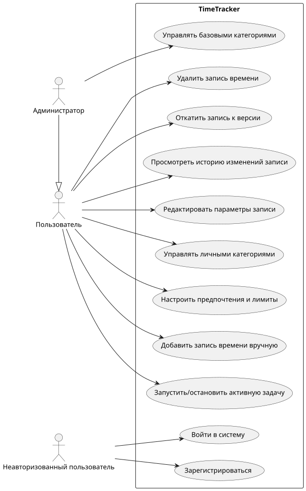

## 8. ER-диаграмма сущностей
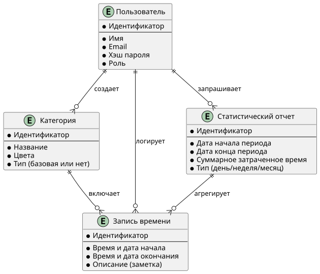

## 9. Пользовательские сценарии

#### Сценарий 1: Запуск и остановка таймера (активной задачи)
*Актор: Пользователь*  
*Экран:* `/timer` (Эскиз 2)  
1. Пользователь открывает экран таймера и выбирает категорию из списка.
2. Пользователь нажимает кнопку «Старт».
3. Система фиксирует `startTime`, создавая открытую запись `TimeRecord` с `endTime = null`. Секундомер начинает отсчет. При этом пользователь может параллельно запускать другие задачи.
4. По завершении активности пользователь нажимает «Стоп».
5. Система фиксирует `endTime` и вычисляет длительность.
6. *Критерий успеха:* Если проверка минимальной длительности отключена или длительность $\ge$ порогу из настроек пользователя (`minDuration`), запись `TimeRecord` сохраняется в БД и отображается в истории дня. При превышении порога `maxActiveDuration` задача автоматически завершается системой.
7. *Критерий ошибки:* Если длительность меньше установленного минимального порога при включенном контроле, операция завершается ошибкой `422 DURATION_TOO_SHORT`.

#### Сценарий 2: Добавление записи вручную
*Актор: Пользователь*  
*Экран:* `/records` (Эскиз 3)  
1. Пользователь открывает форму добавления записи.
2. Выбирает категорию, указывает дату, время начала (14:00) и окончания (15:30), вводит описание.
3. Пользователь нажимает «Сохранить».
4. Система валидирует интервал ($T_{start} < T_{end}$) и минимальную длительность.
5. *Критерий успеха:* Запись сохраняется в БД и появляется в таймлайне дня (пересечение с другими записями разрешено).
6. *Критерий ошибки:* При $T_{end} \le T_{start}$ форма подсвечивает ошибку `422 INVALID_TIME_RANGE` без потери введенных данных.

#### Сценарий 3: Создание новой базовой категории
*Актор: Администратор*  
*Экран:* `/categories` (Эскиз 4)  
1. Администратор авторизуется и переходит в раздел категорий.
2. Вводит название категории, выбирает цвет в формате HEX и отмечает флаг «Базовая».
3. Нажимает кнопку «Создать».
4. *Критерий успеха:* Проверяется роль `ADMIN`, уникальность имени и формат цвета; категория сохраняется с `isDefault = true` и становится доступна всем пользователям.
5. *Критерий ошибки:* При отсутствии прав администратора запрос отклоняется (`403 Forbidden`). При некорректном HEX-коде выводится сообщение валидации.

#### Сценарий 4: Редактирование записи и откат к версии
*Актор: Пользователь*  
*Экран:* `/records/{id}/history` (Эскиз 5)  
1. Пользователь открывает запись и изменяет параметры (время начала/конца, категорию или описание).
2. Полный снимок предыдущего состояния сохраняется в `RecordHistoryEntry` со временем изменения `modifiedAt`, а запись обновляется.
3. Пользователь переходит в историю изменений записи и нажимает «Откатить» у выбранной версии.
4. *Критерий успеха:* Запись восстанавливает все параметры выбранного снимка, операция фиксируется в аудит-логе (forward-only откат).

## 10. Формализация ключевых бизнес-процессов

#### Запуск и остановка таймера
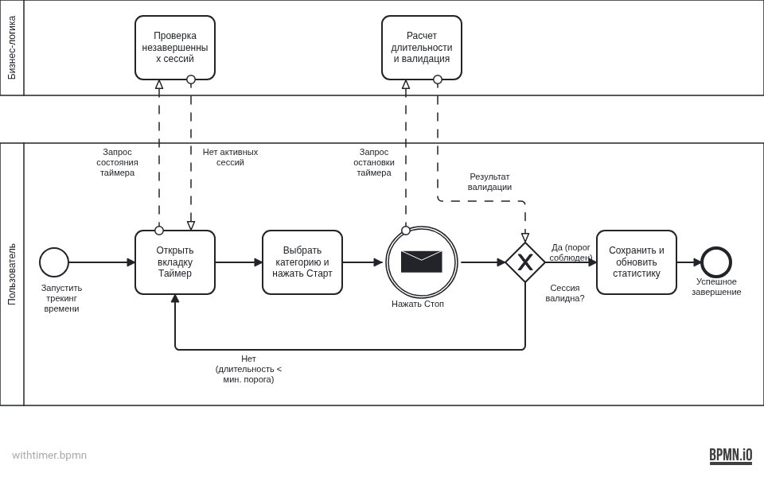

#### Добавление записи вручную
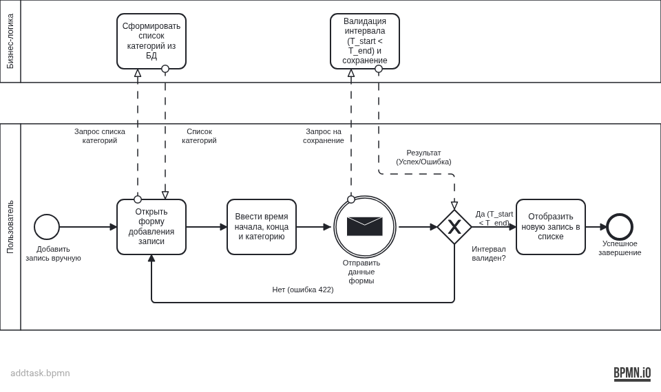

#### Создание новой базовой категории
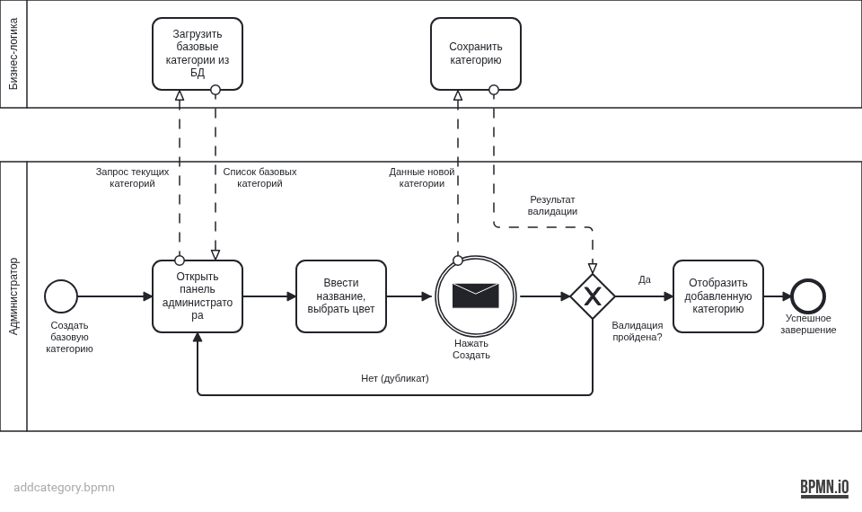

## 11. Описание типа приложения и технологический стек
- **Тип приложения:** Web SPA + REST API сервис (с сохранением легаси TUI и Android клиентов).
- **Backend:** Kotlin JVM, Ktor Server (переиспользование чистого ядра бизнес-логики `:domain`), Koin DI.
- **Frontend:** TypeScript, React, Vite (декларативный компонентный UI).
- **СУБД:** PostgreSQL (реляционная СУБД для серверного веб-бэкенда); SQLite/Room сохраняется для локальных легаси клиентов.
- **Механизм доставки:** Docker, Nginx (раздача статики SPA, маршрутизация API запросов).

## 12. Раскрытие проекта на уровнях L1 и L2 нотации С4
### Уровень L1 (Контекст):
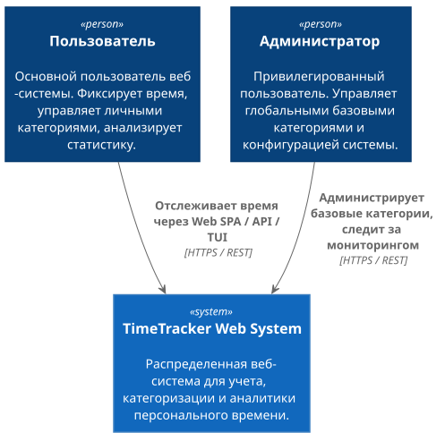  

### Уровень L2 (Контейнеры):
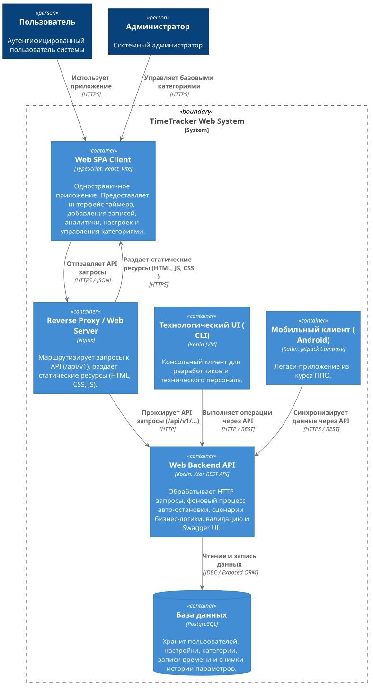  

## 13. Раскрытие проекта на уровне L3 нотации С4
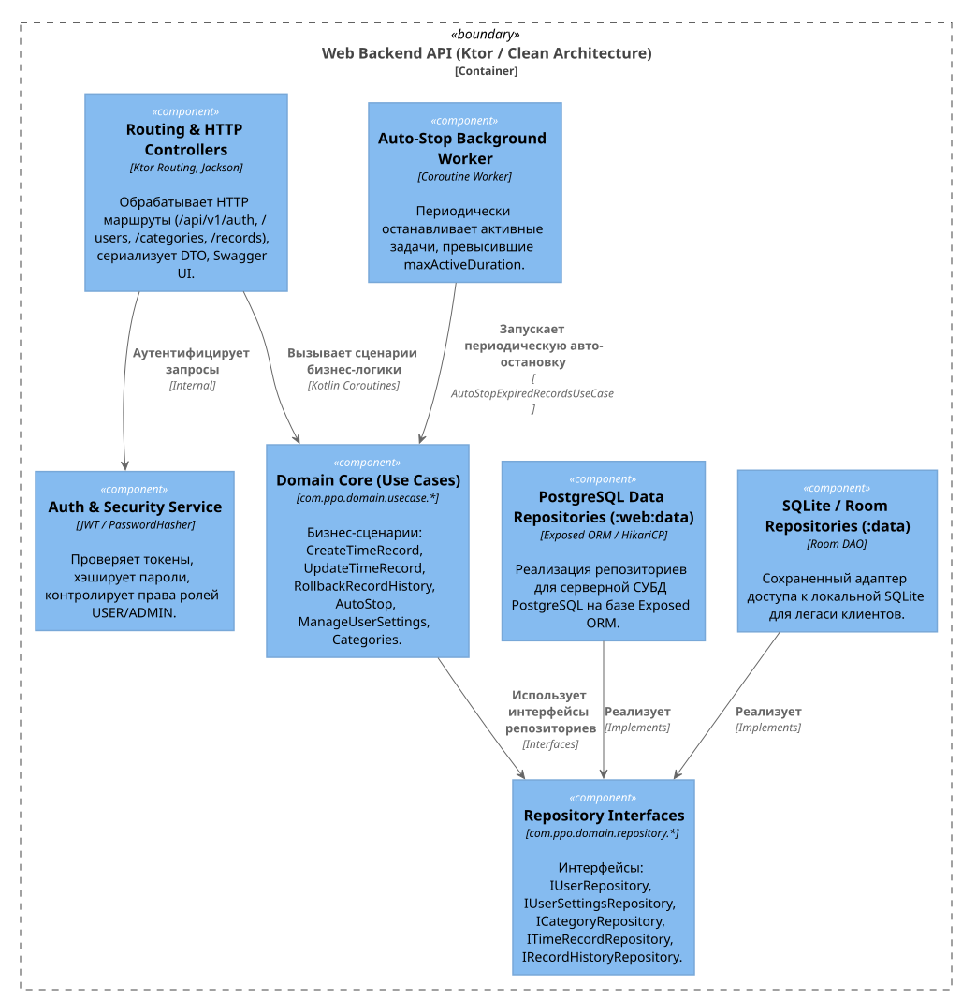  

## 14. Диаграмма БД в нотации DBML
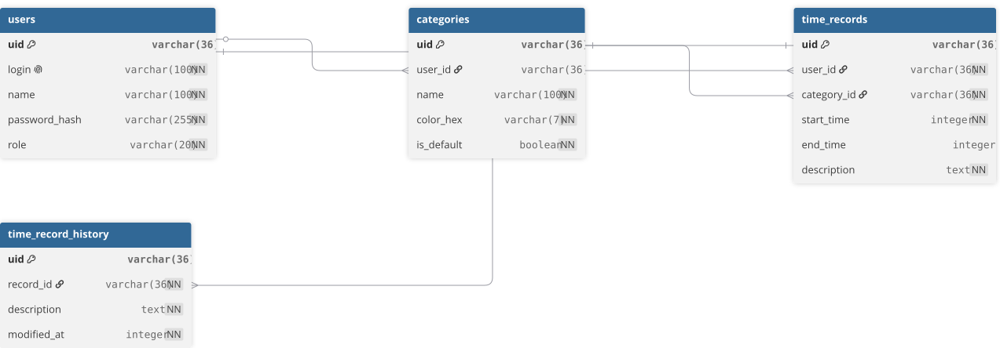

## 15. Черновые эскизы экранов веб-приложения (Wireframes)
*Детальный анализ покрытия прецедентов в эскизах:* [docs/WIREFRAMES_ANALYSIS.md](docs/WIREFRAMES_ANALYSIS.md)

#### Эскиз 1: Вход в систему (`/login`)
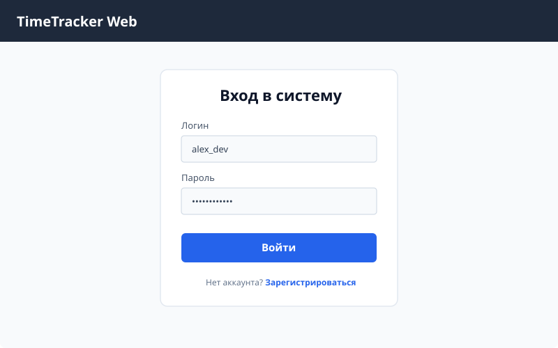

#### Эскиз 2: Главный экран (`/timer`)
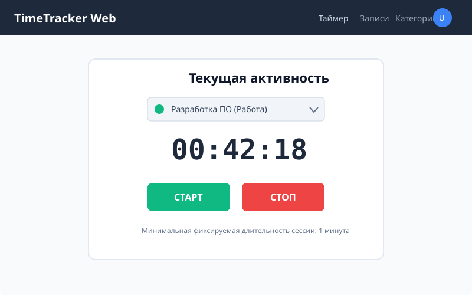

#### Эскиз 3: Добавление записи вручную и таймлайн (`/records`)
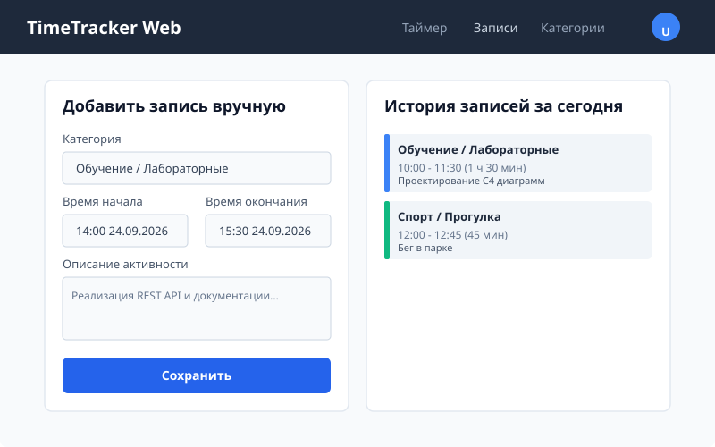

#### Эскиз 4: Управление категориями (`/categories`)
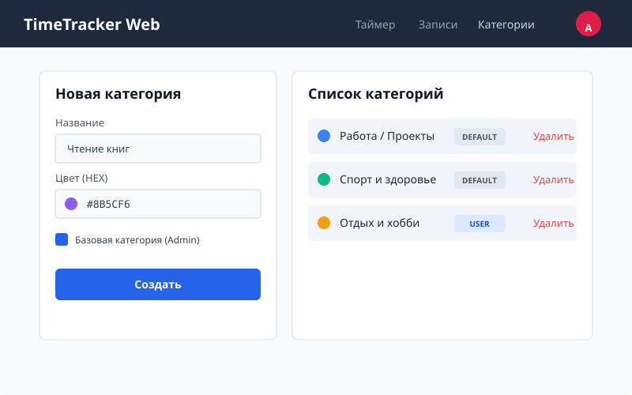

#### Эскиз 5: История версий описания и откат (`/records/{id}/history`)
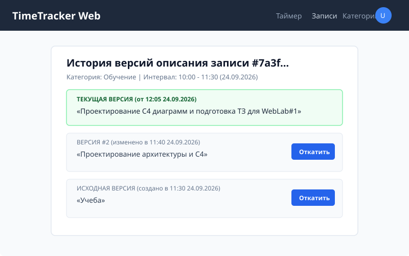

## 16. Архитектурные решения (ADR)
Все решения вынесены в отдельные файлы в каталоге [`docs/adr/`](docs/adr/):
- **[ADR-001: Выбор стека и архитектуры веб-бэкенда](docs/adr/ADR-001-backend-stack.md):** Выбран Kotlin + Ktor для 100% переиспользования чистого ядра `:domain`.
- **[ADR-002: Выбор архитектуры хранения данных для Web](docs/adr/ADR-002-database.md):** Выбрана СУБД PostgreSQL для многопользовательского серверного контура с сохранением SQLite для легаси клиентов.
- **[ADR-003: Выбор фронтенд-стека и сборщика для Web SPA](docs/adr/ADR-003-frontend-stack.md):** Выбран TypeScript + React + Vite для быстрого компонентного SPA и интеграции с OpenAPI.
