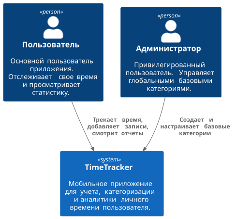
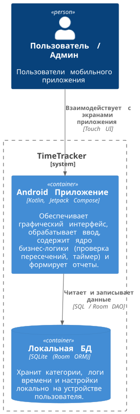
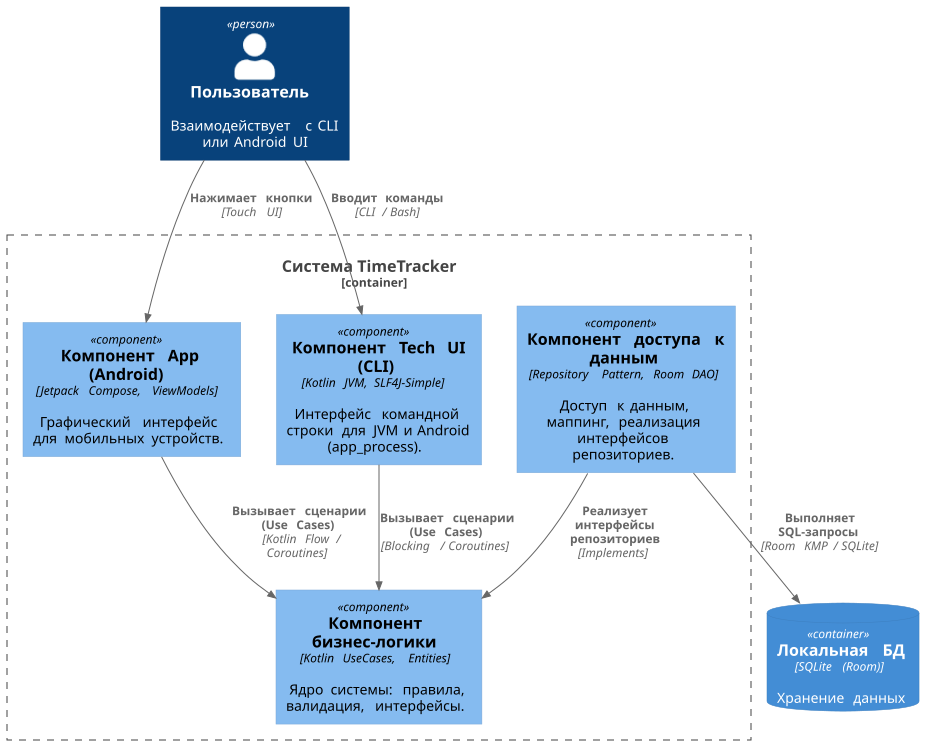
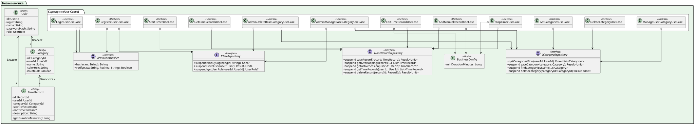
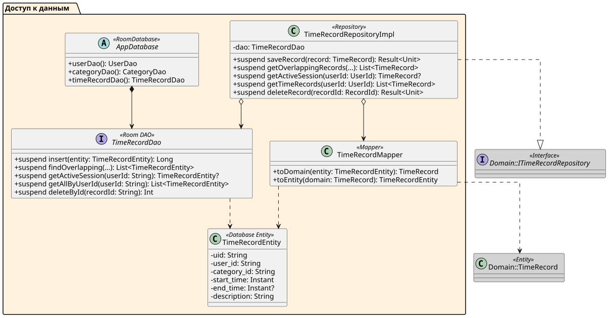
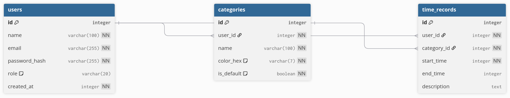

## 1. Название проекта
**TimeTracker**

## 2. Краткое описание идеи проекта
Проект представляет собой приложение-таймтрекер для учета, категоризации и анализа распределения личного времени. Пользователь может фиксировать затраченное на различные дела время вручную или с помощью встроенного секундомера, привязывая активности к настраиваемым категориям (учеба, отдых, дорога). Накопленные данные используются для построения статистики по дням, неделям и месяцам, что помогает выявлять оптимизировать распорядок дня.

## 3. Краткое описание предметной области
Предметная область приложения — управление личным временем (тайм-менеджмент) и аналитика продуктивности пользователя. В системе ведется строгий хронологический учет временных интервалов (сессий), потраченных на выполнение конкретных задач. Основными сущностями предметной области являются: **Пользователь** (владелец данных и настроек), **Категория** (тип деятельности, характеризующийся названием и цветом), **Запись времени** (конкретный временной интервал, имеющий время начала, время окончания и привязанную категорию) и **Статистический отчет** (агрегированные данные о затраченном времени за выбранный период).

## 4. Краткий анализ аналогичных решений
Критерии:
*   Удобство таймера (в 1 клик): Важно для минимизации барьера входа; если запуск трекера долгий, пользователь перестанет им пользоваться.
*   Доступность глубокой аналитики: Многие сервисы прячут графики и детализацию за платной подпиской.
*   Ориентация интерфейса: Большинство популярных систем нацелены на B2B (команды, выставление счетов клиентам), что перегружает интерфейс для обычного человека.

| Название аналога | Наличие быстрого таймера (в 1 клик) | Глубокая аналитика в бесплатной версии | Ориентация продукта (B2B / B2C) |
| :--- | :--- | :--- | :--- |
| Toggl Track | Да | Ограничена (расширенные отчеты платные) | B2B |
| Clockify | Да | Частично (многое доступно, но UI перегружен) | B2B |
| aTimeLogger | Нет (упор на ручной ввод) | Да | B2C |
| TimeTracker | Да | Да | B2C |

## 5. Краткое обоснование целесообразности и актуальности проекта
В современном мире люди часто сталкиваются с проблемой прокрастинации и неэффективного расхода времени на нецелевые задачи. Существующие популярные решения (Toggl, Clockify) в основном ориентированы на корпоративный сектор, перегружены лишним функционалом (биллинг, команды, проекты) или ограничивают возможности аналитики в бесплатных версиях. Разработка собственного минималистичного тайм-трекера позволит создать удобный инструмент с фокусом исключительно на личную продуктивность и бесплатную детальную статистику.

## 6. Краткое описание акторов (ролей)
1.  **Пользователь:** Основной актор системы. Запускает и останавливает таймер, добавляет или редактирует прошедшие записи времени, создает пользовательские категории для активностей и запрашивает вывод личной статистики.
2.  **Администратор:** Привилегированный актор. Имеет все возможности обычного пользователя, а также дополнительно управляет базовыми (системными) категориями, которые доступны всем пользователям по умолчанию.

## 7. Use-Case диаграмма

## 8. ER-диаграмма сущностей

## 9. Пользовательские сценарии
#### Сценарий 1: Запуск и остановка таймера
*Актор: Пользователь*
1. Пользователь открывает главный экран приложения (вкладка "Таймер").
2. Пользователь выбирает из выпадающего списка категорию активности.
3. Пользователь нажимает кнопку "Старт".
4. Система фиксирует текущее время как время начала и начинает отображать на экране секундомер.
5. По завершении активности Пользователь нажимает кнопку "Стоп".
6. Система фиксирует время остановки, вычисляет длительность, проверяет, что она больше 1 минуты, сохраняет запись времени в базу данных.

#### Сценарий 2: Добавление записи вручную
*Актор: Пользователь*
1. Пользователь переходит на экран "Добавить запись вручную".
2. Система запрашивает у базы данных актуальный список категорий и отображает форму.
3. Пользователь выбирает категорию, указывает дату, время начала (15:00) и время окончания (16:30).
4. Пользователь нажимает кнопку "Сохранить".
5. Система отправляет данные на валидацию. Бизнес-логика обнаруживает, что в этот день с 15:30 до 16:00 уже есть запись.
6. Система возвращает ошибку и выводит на экран сообщение об ошибке.
7. Пользователь корректирует время начала на 16:00 и снова нажимает "Сохранить".
8. Система успешно валидирует данные и сохраняет запись.

#### Сценарий 3: Создание новой базовой категории
*Актор: Администратор*
1. Администратор авторизуется в системе и переходит в "Панель управления".
2. Выбирает раздел "Базовые категории" и нажимает кнопку "Добавить категорию".
3. Вводит название категории, выбирает цвет.
4. Нажимает кнопку "Создать".
5. Система сохраняет категорию в базу данных.
6. С этого момента при регистрации новых пользователей эта категория автоматически появляется в их списке доступных категорий.

## 10. Формализация ключевых бизнес-процессов

#### Запуск и остановка таймера

#### Добавление записи вручную

#### Создание новой базовой категории

## 11. Описание типа приложения
- Тип приложения: Mobile App (Android).
- Язык программирования: Kotlin.
- Паттерн слоя представления (UI): MVVM, отрисовка UI: Jetpack Compose.
- СУБД: SQLite, ORM: Room.
- DI: Koin.

## 12. Раскрытие проекта на уровнях L1 и L2 нотации С4
### Уровень L1:

### Уровень L2:

## 13. Раскрытие проекта на уровне L3 нотации С4

## 14. Раскрытие проекта на уровне L4 нотации С4

## 15. UML-диаграммы последовательностей

#### Запуск и остановка таймера

#### Добавление записи вручную

#### Создание новой базовой категории

## 16. Диаграмма БД в нотации DBML

